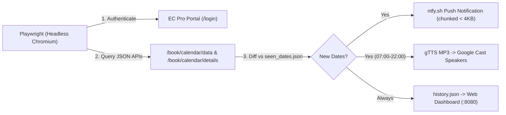

# EC Pro Lesson Watcher

An automated, self-hosted booking availability monitor, zero-dependency web dashboard, and smart-speaker announcer for **EC Pro** riding school portals.

Built to solve a real-world problem: riding stables release new lesson slots without sending notifications, and popular slots fill up quickly. This bot polls the portal on a schedule, detects newly added dates, and alerts both your phone and smart speakers with the exact lesson times and instructors.

---

## Architecture



## Key Engineering Highlights

- **API-First Scraping:** Instead of brittle DOM scraping across single-day pages, the watcher authenticates via Playwright and queries EC Pro's internal `/book/calendar/data` and `/book/calendar/details` JSON endpoints across a configurable multi-month window.
- **Persistent Session Loop (`--loop`):** For self-hosting on low-power hardware (tested on a repurposed **Intel Celeron N4020 / 4 GB RAM** laptop running **Ubuntu Server 24.04 LTS**), `--loop` keeps a single authenticated browser session alive and only re-authenticates on session expiry (`401`/`403`/`419`).
- **Chunked Push Notifications:** Automatically splits large multi-date alerts by date under 3.5 KB so `ntfy.sh` always delivers inline push notifications rather than converting long payloads into `.txt` attachments.
- **Smart Speaker Announcements with Quiet Hours:** Generates spoken UK-English MP3 alerts with `gTTS`, serves them from the local dashboard server, and casts them via `pychromecast` to Google Nest/Chromecast devices—respecting configurable quiet hours (`22:00–07:00`).
- **Zero-Dependency Web Dashboard:** Built with Python's standard library `ThreadingHTTPServer` (`dashboard.py`) to display service health, total checks, notification history, open lessons with direct booking links, and live `journalctl` logs.
- **Dual Deployment:** Runs either 24/7 on a home Linux server via `systemd` or serverless on **GitHub Actions**.

---

## Quick Start (Self-Hosted Ubuntu Server)

### 1. Install Dependencies

```bash
git clone <your-repo-url> ecpro-lesson-watcher
cd ecpro-lesson-watcher
python3 -m venv .venv
.venv/bin/pip install -r requirements.txt
.venv/bin/playwright install chromium
sudo .venv/bin/playwright install-deps chromium

# Optional: for Google Cast speaker announcements
.venv/bin/pip install pychromecast gTTS
```

### 2. Configure Environment

```bash
cp .env.example .env
chmod 600 .env
# Edit .env with your EC Pro URL, login credentials, and ntfy topic
```

Test with a dry run:

```bash
.venv/bin/python watcher.py --dry-run
```

### 3. Run as `systemd` Services

Copy the unit files in `deploy/` (updating `User=` and paths if not `ubuntu`):

```bash
sudo cp deploy/ecpro-watcher.service /etc/systemd/system/
sudo cp deploy/ecpro-dashboard.service /etc/systemd/system/
sudo systemctl daemon-reload
sudo systemctl enable --now ecpro-watcher ecpro-dashboard
```

Open `http://<server-ip>:8080` in any browser on your local network to view the dashboard.

---

## Alternative: GitHub Actions (Serverless)

1. Push to a **private** GitHub repository.
2. Add Repository Secrets under **Settings → Secrets and variables → Actions**:
   - `ECPRO_BASE_URL` (e.g. `https://your-stables.ecpro.co.uk`)
   - `ECPRO_EMAIL`
   - `ECPRO_PASSWORD`
   - `NTFY_TOPIC`
3. Enable **Read and write permissions** under **Settings → Actions → General → Workflow permissions** so the workflow can commit `seen_dates.json` between runs.

---

## CLI Flags

- `python watcher.py` — Run a single check and exit.
- `python watcher.py --loop 900` — Poll continuously every 900 seconds (15 minutes) using a persistent session.
- `python watcher.py --dry-run` — Print available dates/lessons without sending notifications or updating state.
- `python watcher.py --debug` — Save raw `/book/calendar/data` JSON to `./debug/`.
- `python watcher.py --test-cast` — Trigger a test announcement on configured Google Cast devices.
